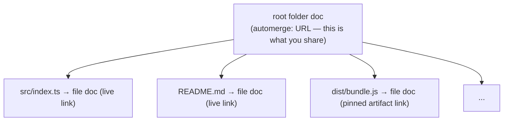
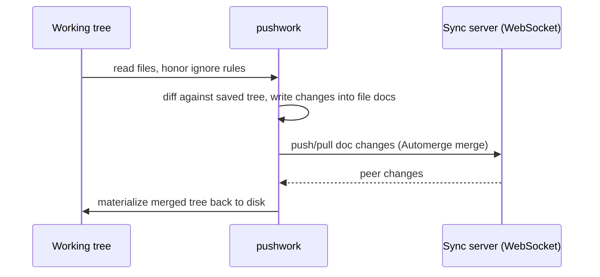

# pushwork

_Bidirectional directory synchronization using [Automerge](https://automerge.org/) CRDTs._

pushwork turns any directory into a synchronized, conflict-free replicated folder. Initialize a directory to get a shareable `automerge:` URL, hand that URL to another machine (or another person), and `clone` it. From then on, `sync` reconciles both working trees through a WebSocket relay — concurrent edits, additions, deletions, and renames all converge automatically because every file is backed by an Automerge document.

It feels a bit like Git, but the "merge" is a CRDT: there are no merge conflicts to resolve by hand, and character-level edits to text files combine cleanly.

## Requirements

- Node.js `>= 24`
- [pnpm](https://pnpm.io/) `>= 8`

## Installation

### From npm (recommended)

```sh
npm install --global pushwork
# or run it without installing:
npx pushwork <command>
```

This puts `pushwork` on your PATH. The examples below assume that.

### From source

```sh
git clone <repo-url> pushwork
cd pushwork
pnpm install
pnpm build        # compiles TypeScript to dist/
```

This produces the `pushwork` binary at `dist/cli.js`. You can then either:

```sh
node dist/cli.js <command>      # run directly
pnpm start -- <command>         # via the start script
pnpm link --global              # expose `pushwork` on your PATH
```

> [!NOTE]
>
> The compiled `dist/` is what the CLI runs (and what the tests exercise), so build before running from source.

## Quick start

```sh
# Machine A — turn a directory into a pushwork repo
cd ~/notes
pushwork init
pushwork url            # prints the automerge: URL to share

# Machine B — clone that URL into a new directory
pushwork clone automerge:2sX...e9 ~/notes-clone

# On either machine, after editing files
pushwork sync           # exchange changes with peers and merge to disk

# Inspect local changes before syncing
pushwork status
pushwork diff
```

## Commands

| Command | Description |
| --- | --- |
| `pushwork init [dir]` | Initialize pushwork in a directory (default `.`). |
| `pushwork clone <url> <dir>` | Clone an `automerge:` URL into a directory. |
| `pushwork sync` | Sync local changes with peers and merge remote changes to disk. |
| `pushwork save` (alias `commit`) | Commit local changes to local storage without contacting the server. |
| `pushwork status` | Show changes against the saved state. |
| `pushwork diff [path]` | Show textual diffs of local changes; optionally limit to `path`. |
| `pushwork url [--draft [draft]]` | Print the `automerge:` URL of this repo, or with `--draft` a draft's (default: the checked-out one). |
| `pushwork heads [pathspec]` | Print Automerge heads for the root folder and every file doc (offline). |
| `pushwork yoink <url> [path]` | Pull a single file doc by URL and write it to disk (default path: the doc's own name). |
| `pushwork yeet <path> <url>` | Push a single file from disk into the file doc at `url`, mutating it in place. |
| `pushwork migrate [dir]` | Upgrade an older `.pushwork/config.json` to the current format. |
| `pushwork cut [name]` | Stash working-tree changes and reset the tree to the saved state (offline). |
| `pushwork paste [id-or-name]` | Re-apply a stashed change set (default: most recent). |
| `pushwork snarfs` (alias `clipboard`) | List stashed change sets, newest first. |
| `pushwork version` | Print pushwork and Automerge package versions. |
| `pushwork draft [name] [start]` | List drafts, or create one (see [Drafts](#drafts)); `-m` renames, `-d`/`-D` deletes. |
| `pushwork switch [draft]` | Switch to a draft (or `main`) and update the working tree; `-c <name>` creates one first. |
| `pushwork checkout [draft]` | Alias for `switch`; `-b <name>` creates a draft first. |
| `pushwork merge` | Merge the checked-out draft into the draft it was forked off, and switch to that. |
| `pushwork import-git [dir]` | Import a git repository into Patchwork, with a draft per branch (see [Importing a git repository](#importing-a-git-repository)). |

### Global options

These apply to every command:

| Flag | Description |
| --- | --- |
| `--porcelain` | Machine-readable output: tab-separated lines, no spinners/colors/prompts. |
| `-q, --quiet` | Suppress progress; show only results and errors. |
| `--silent` | Suppress all output except errors (check the exit code). |
| `-v, --version` | Print version info and exit. |

### `init` / `clone` options

| Flag | Applies to | Description |
| --- | --- | --- |
| `--shape <shape>` | both | Document shape: `vfs` (default), `patchwork-folder`, or a path to a custom shape module. |
| `--artifact-dir <dir>` | both | Directory whose text content is stored atomically (never character-merged). Repeatable. Defaults to `dist`. |
| `--json-docs` | both | Store `.json` files whose `"@patchwork".type` isn't `"file"` as Automerge JSON documents instead of text (see [JSON documents](#json-documents)). |
| `-b, --draft <draft>` | `clone` | Check out this draft (a name, url, or `main`) instead of main (see [Drafts](#drafts)). |
| `--no-sub` | both | Use the legacy WebSocket backend instead of Subduction. |
| `--legacy` | both | Alias for `--no-sub`. |

On `clone`, the shape is normally chosen from the root doc itself (`@patchwork.type` of `directory` → `vfs`, `folder` → `patchwork-folder`); `--shape` is only the fallback when the type isn't recognized.

### `sync` options

| Flag | Description |
| --- | --- |
| `--nuclear` | Re-create every file/folder doc with a fresh URL before syncing, dropping references to the old URLs from this repo. |

## Importing a git repository

```sh
pushwork import-git ~/code/my-repo     # prints the root's automerge: URL
```

`import-git` reads a git repository (git itself is left untouched) and makes a Patchwork root the way strand's drafts lay one out:

- **Main** is the checked-out branch (or `--main <branch>`), built by replaying its first-parent history one commit at a time, from the oldest commit a draft needs (just the tip when there are none; `--history` replays the last `--depth` commits, default 200).
- **Every other local branch** (or each `--branch <name>`) becomes a draft named after it (see [Drafts](#drafts)), forked off main as of the commit it branched from, with the branch's files written through the draft so only the docs it changes are cloned into it. Branches already merged into main are skipped, as are ones that started further back than `--depth`.
- **Each replayed commit and each branch tip is recorded as a sync point**, so strand's git sync starts out connected (main's on the root's overlay index, each draft's on the draft) to the GitHub repository `origin` points at (`--github owner/repo` to name another, `--no-github` for none) with every draft linked to its branch. Push the branches first: strand compares them with GitHub's.

Files are stored as `init` stores them, so `.pushworkattributes` datatype and artifact rules apply. Only regular and executable files are imported; symlinks and submodules stay in git. The automerge storage goes in a temporary directory that's removed once the sync server has everything; `--storage <dir>` keeps it, and `--offline` imports without publishing.

## Drafts

A draft is a line of edits forked off main (or off another draft) that can be merged back later. Drafts are stored the way strand stores them, so a draft made here shows up in Patchwork and one made there shows up here:

- The root's `@patchwork.overlaysUrl` points at an _overlay index_ listing its drafts and merges.
- A draft doc records the draft it was forked off (`null` for main) and, for every doc, the version it branched off. Forking copies nothing: a doc is cloned into the draft the first time the draft changes it.
- Merging a draft merges each doc it cloned into the parent's version and takes the draft off the list.

The commands work like git's branch commands:

```sh
pushwork draft                    # list drafts; * marks the checked-out one (--tree shows forks)
pushwork draft fix-typos          # fork a draft off the checked-out one (or: draft <name> <start>)
pushwork switch fix-typos         # check it out and update the working tree
pushwork switch -c try-this main  # fork off main and switch to it (checkout -b works too)
pushwork draft -m better-name     # rename the checked-out draft (draft -m <old> <new> for another)
pushwork merge                    # merge into the draft it was forked off, and switch there
pushwork draft -d fix-typos       # delete a draft; -D even if it has unmerged changes
```

`save` and `sync` write to the checked-out draft, which `status` names and `.pushwork/config.json` records under `draft`. Draft commands are offline; `sync` publishes drafts and brings in ones made elsewhere. Switching or merging needs a clean working tree, except when you create a draft off the checked-out one and switch to it, which keeps your unsaved changes. To check out a draft on another machine, pass its URL (`pushwork url --draft`) or name to `clone --draft`.

## Sync backends

pushwork supports two WebSocket sync backends. **Subduction is the default.**

| Backend | Default endpoint | Selected by |
| --- | --- | --- |
| `subduction` | `wss://subduction.sync.inkandswitch.com` | default |
| `legacy` | `wss://sync3.automerge.org` | `--legacy` / `--no-sub` |

Override either endpoint with an environment variable:

```sh
PUSHWORK_SUBDUCTION_SERVER=wss://my-relay.example.com pushwork sync
PUSHWORK_LEGACY_SERVER=wss://my-relay.example.com pushwork sync --legacy
```

## Configuration

pushwork stores all of its metadata under `.pushwork/` at the repo root:

| Path | Contents |
| --- | --- |
| `.pushwork/config.json` | Repo configuration (see below). |
| `.pushwork/storage/` | Automerge CRDT storage (`NodeFSStorageAdapter`). |
| `.pushwork/bases.json` | Per-path merge bases: the version last written to disk (see [Links and merge bases](#links-and-merge-bases)). |
| `.pushwork/snarf/index.json` | Local stash entries (see [Stashing changes](#stashing-changes)). |

`config.json` is currently at version `7`:

```json
{
	"version": 7,
	"rootUrl": "automerge:2sX...e9",
	"backend": "subduction",
	"shape": "vfs",
	"artifactDirectories": ["dist"],
	"jsonDocuments": false,
	"draft": null
}
```

`draft` is the checked-out draft's URL, or `null` for main.

If the config version doesn't match the installed pushwork, commands fail with a prompt to run `pushwork migrate`.

### Ignore files

The following are always ignored: `.pushwork`, `.git`, and `node_modules`. Symlinks are skipped during traversal.

For anything else, add a `.pushworkignore` file at the repo root. It uses gitignore syntax (blank lines and `#` comments are ignored):

```gitignore
# .pushworkignore
*.log
tmp/
.env
```

### Links and merge bases

Folder and file links inside the tracked tree are live `automerge:` URLs, so opening any document from the folder (in Patchwork, say) gives you an editable document. Only [artifact files](#artifact-files) are linked as heads-_pinned_ snapshots (`automerge:<docId>#<heads>`). Each checkout records the version it last wrote to disk per path in `.pushwork/bases.json`; that is the base for sync's three-way reconcile, so a browser edit and a concurrent disk edit merge instead of one undoing the other. Links pinned by an older pushwork serve as the base on their first sync, which rewrites them live. See [`design/artifacts.md`](./design/artifacts.md) and [`design/sync.md`](./design/sync.md).

### Artifact files

Files marked as _artifacts_ are treated as build output: their text content is stored as an atomic immutable string that is replaced whole rather than character-merged. By default the `dist` directory is an artifact directory; configure the default list with `--artifact-dir <dir>` (repeatable) at `init`/`clone` time, which is recorded in `.pushwork/config.json` (local to your checkout).

#### `.pushworkattributes` (travels with the repo)

`--artifact-dir` only configures _your_ checkout. To make artifact rules travel with the repo so every collaborator agrees, add `.pushworkattributes` files. They're ordinary tracked files (synced like any other content) modeled on `.gitattributes`, and siblings to `.pushworkignore`:

```gitattributes
# .pushworkattributes
dist/**     artifact
build/**    artifact
*.wasm      artifact
vendored/   -artifact     # negate a default; last matching rule wins
```

Each line is `<glob> <attr>...` (blank lines and `#` comments ignored). Patterns are gitignore-style globs; the attributes are `artifact` (`-artifact` unsets it) and `datatype` (see [Datatypes by file ending](#datatypes-by-file-ending)). An attributes file may sit in **any directory**: its patterns are relative to its own location and apply only to its subtree, with deeper files overriding shallower ones for the paths they match. When any attributes file is present, its `artifact` rules **override** `artifactDirectories` from `.pushwork/config.json`, and pushwork warns when the two disagree so a stale local config can't silently diverge from the repo.

### JSON documents

With `jsonDocuments` on (`--json-docs` at `init`/`clone`, or `"jsonDocuments": true` in `.pushwork/config.json`), a `.json` file holding an object whose `"@patchwork"` field has a `type` other than `"file"` is stored as that object, not as text. The file _is_ the Patchwork document, and a `patchwork-folder` link carries its type, so Patchwork opens it with the matching tool:

```json
{
	"@patchwork": { "type": "stock-flow-model" },
	"title": "Housing",
	"variables": { "students": { "initial": 100 } }
}
```

Edits are diffed key by key, so concurrent changes to different keys merge. Automerge keeps neither key order nor whitespace, so pushwork compares values rather than bytes, leaves a file alone while its value matches the document, and when it must rewrite one, reuses that file's own indentation and key order. A file received from a peer with no local copy yet is written with two-space indent. If a tracked JSON document's file stops parsing as an object, sync warns and leaves that file unsynced until it does.

The flag decides only how new files are stored: a path already tracked as a JSON document stays one, whoever syncs it. Turning the flag on for an existing repo converts qualifying text files on the next sync, giving them a new document URL.

A JSON document's `@patchwork` field is never removed by a file that omits it: the document keeps the metadata it has.

#### Datatypes by file ending

To store files of a given ending as a Patchwork datatype, without writing `@patchwork` into each one, add a `datatype` rule to `.pushworkattributes`. Because the rule lives in a tracked file, everyone who clones the folder gets the same datatypes:

```gitattributes
*.kanban   datatype=kanban  import=automerge:2a5Rkw9LkqXfBAQZbcBWjTcf15Mc
*.tldraw   datatype=tldraw  import=https://example.com/tldraw/dist/index.js  strip-metadata
drafts/    -datatype
```

A matching file that holds a JSON object is stored as a JSON document whatever its extension, and with or without `jsonDocuments`. The rule sets `@patchwork.type` and, with `import=`, `@patchwork.suggestedImportUrl`, so Patchwork can load the tool for it; an `automerge:` URL pinned to heads also sets `frozenImportUrl`. Changing a rule updates the documents it covers on the next sync.

By default the `@patchwork` field is written to disk like any other key. Add `strip-metadata` to a rule to keep it out of the files: pushwork rebuilds it from the rule and the document whenever it reads the file back, and fields Patchwork adds to the metadata are kept.

## Document shapes

A _shape_ controls how the directory tree is encoded into Automerge documents.

| Shape | Value | Structure |
| --- | --- | --- |
| VFS _(default)_ | `vfs` | A single directory doc (`@patchwork.type: "directory"`) whose keys are posix file paths mapping to file-doc URLs. |
| Patchwork folder | `patchwork-folder` | A recursive folder-of-docs (`@patchwork.type: "folder"`) compatible with Patchwork and original pushwork repos. |
| Custom | _module path_ | A module with a `default` export implementing `{ encode, decode }`. |

Select a shape with `--shape` at `init`/`clone`.

## Stashing changes

pushwork has a local "clipboard" for working-tree changes — handy for setting aside in-progress edits. These stashes (called _snarfs_) are stored locally and are never synced.

```sh
pushwork cut "wip-refactor"   # stash changes, reset tree to saved state
pushwork snarfs               # list stashes (newest first)
pushwork paste                # re-apply the most recent stash
pushwork paste wip-refactor   # or re-apply a specific one by id or name
```

## Sharing a single file

`yoink` and `yeet` move one file doc around by URL, independent of any folder structure. Find a file's doc URL with `heads`, then pull or push it from anywhere:

```sh
pushwork heads notes/todo.md        # → notes/todo.md  automerge:abcd…  <heads>
pushwork yoink automerge:abcd        # write that doc to ./todo.md (its own name)
pushwork yoink automerge:abcd grabbed.md   # …or to an explicit path
pushwork yeet draft.md automerge:abcd      # overwrite the doc with draft.md
```

Both run inside an initialized repo (they use its backend and storage) and contact the sync server. `yoink` is detached: the file it writes is an ordinary working-tree file, not linked back to the source doc — a later `save` or `sync` tracks it under a fresh file doc like any other path. `yeet` mutates the target doc in place (text merges character-by-character; binary is last-writer-wins), so peers holding that URL see the change.

## How it works

A pushwork repo is a tree of Automerge documents. One _root folder doc_ (whose URL is what you share) references one _file doc_ per file. The folder URL is stable for the life of the repo, so sharing it once is enough.



A `sync` performs a full round trip:



`save` (alias `commit`) runs the same pipeline _offline_ — it commits to local CRDT storage and never contacts a server.

## Migrating older repos

If you have a repo created by an older pushwork (or the original pushwork "main" repo with a `.pushwork/config.json` predating versioning), upgrade it in place:

```sh
pushwork migrate          # operates on the current directory
pushwork migrate ./repo
```

Migration walks the config forward one version at a time and reports the steps taken, or that the repo is already up to date.

## Programmatic API

The package also exposes a library API (`import` from `pushwork`). Functions that talk to the network accept `online: false` for fully offline operation.

```ts
import {init, clone, sync, save, status} from "pushwork"

// Initialize a repo
const {url, files} = await init({
	dir: "./my-project",
	backend: "subduction", // or "legacy"
	shape: "vfs",
})
console.log(`Initialized ${files} files at ${url}`)

// Clone it elsewhere
await clone({url, dir: "./clone-target", backend: "subduction", shape: "vfs"})

// Sync / inspect
await sync("./my-project") // online by default
await save("./my-project") // offline commit
const {diff} = await status("./my-project")
```

### Exported functions

| Function | Signature |
| --- | --- |
| `init` | `(opts: InitOpts, report?: Reporter) => Promise<RepoSummary>` |
| `clone` | `(opts: CloneOpts, report?: Reporter) => Promise<RepoSummary>` |
| `sync` | `(cwd: string, opts?: { nuclear?: boolean }, report?: Reporter) => Promise<void>` |
| `save` | `(cwd: string, report?: Reporter) => Promise<void>` |
| `status` | `(cwd: string) => Promise<{ diff: Diff }>` |
| `diff` | `(cwd: string, limitToPath?: string) => Promise<Array<{ path; kind; before?; after? }>>` |
| `url` | `(cwd: string) => Promise<AutomergeUrl>` |
| `heads` | `(cwd: string, pathspec?: string) => Promise<HeadsEntry[]>` |
| `cutWorkdir` | `(cwd: string, opts?: { name?: string }) => Promise<{ id; entries }>` |
| `pasteSnarf` | `(cwd: string, selector?: string) => Promise<{ id; entries; name? }>` |
| `showSnarfs` | `(cwd: string) => Promise<Snarf[]>` |
| `nuclearizeRepo` | `(cwd: string) => Promise<void>` |

Configuration and migration helpers (`migrate`, `migrations`, `detectVersion`, `readRawConfig`, `CONFIG_VERSION`) and shape helpers (`vfsShape`, `patchworkFolderShape`, `pinUrl`, `stripHeads`, `isInArtifactDir`, `normalizeArtifactDir`) are exported as well.

Key option types:

```ts
type Backend = "legacy" | "subduction"

type InitOpts = {
	dir: string
	backend: Backend
	shape: string // "vfs" | "patchwork-folder" | module path
	artifactDirectories?: readonly string[] // default: ["dist"]
	jsonDocuments?: boolean // default: false
	online?: boolean // default: true
}

type CloneOpts = InitOpts & {
	url: string
	// optional interactive hooks for legacy "branches" / strategy docs:
	onBranchesDoc?: (info) => AutomergeUrl | Promise<AutomergeUrl>
	onStrategyDoc?: (info) => boolean | Promise<boolean>
}
```

## Environment variables

| Variable | Default | Purpose |
| --- | --- | --- |
| `PUSHWORK_SUBDUCTION_SERVER` | `wss://subduction.sync.inkandswitch.com` | Subduction sync endpoint. |
| `PUSHWORK_LEGACY_SERVER` | `wss://sync3.automerge.org` | Legacy WebSocket sync endpoint. |
| `PUSHWORK_WS_INLINE` | _off_ | Set to `1` to open the sync WebSocket on the main thread instead of a worker thread. |
| `DEBUG` | _off_ | Set `DEBUG=true` (rewritten to `DEBUG=*`) to enable `pushwork:*` debug logs. |

### Concurrency

pushwork runs a single Automerge `Repo` over one sync connection. The WebSocket (and its frame decoding) lives in a worker thread so a busy main thread never stalls reads or keepalives, and per-file document fetches during clone/pull are pipelined concurrently over that one connection. Every synced document sits under the same delivery check, so the final `SYNCED`/`PENDING` verdict covers the whole tree.

## Development

| Script | Description |
| --- | --- |
| `pnpm build` | Compile TypeScript to `dist/`. |
| `pnpm dev` | `tsc --watch`. |
| `pnpm test` | Run the Vitest suite. |
| `pnpm test:watch` / `pnpm test:coverage` | Watch / coverage modes. |
| `pnpm typecheck` | `tsc --noEmit`. |
| `pnpm lint` / `pnpm lint:fix` | ESLint over `src`. |
| `pnpm bench` | Build and run the sync benchmark harness. |

```sh
# Example benchmark runs
npx tsx bench/sync-bench.ts --files 2000 --size 512 --text 1 --fanout 20
npx tsx bench/sync-bench.ts --clone-local --files 3000
```

## Design

The [`design/`](./design/) directory documents how pushwork works under the hood: [document shapes](./design/shapes.md), [sync verdicts](./design/sync.md), [artifact directories](./design/artifacts.md), [config & migrations](./design/config.md), and [snarfs](./design/snarf.md).

## Contributing

See [CONTRIBUTING.md](./CONTRIBUTING.md). This project follows a [code of conduct](./CODE_OF_CONDUCT.md).

## License

Licensed under either of:

- Apache License, Version 2.0 ([LICENSE-APACHE](./LICENSE-APACHE) or <http://www.apache.org/licenses/LICENSE-2.0>)
- MIT license ([LICENSE-MIT](./LICENSE-MIT) or <http://opensource.org/licenses/MIT>)

at your option.

Unless you explicitly state otherwise, any contribution intentionally submitted for inclusion in the work by you, as defined in the Apache-2.0 license, shall be dual licensed as above, without any additional terms or conditions.

© Ink & Switch
