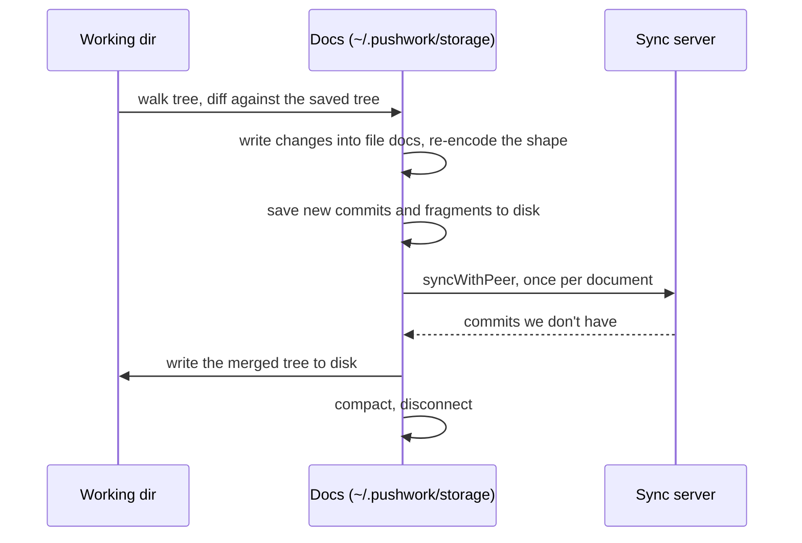

# Sync

pushwork runs one Subduction node per command (`src/docs.ts`). Documents are loaded from the machine store, `~/.pushwork/storage`, changed in memory, saved back, and synced with the server one document at a time. Every checkout on the machine shares that store; each keeps its own record of the heads it has seen (see below). Nothing is kept between commands except what is on disk.

## Flow

The steps of `sync`, in order (`commitWorkdir` in `src/pushwork.ts`):

1. Decode the saved tree. This is local: we diff against the last local state, not the remote one.
2. Walk the working directory and write changed files into their docs.
3. If the tree changed, re-encode it into the root.
4. `docs.sync()`: save, then sync every document this run has loaded (the whole tree).
5. `docs.advance()`: this checkout has now seen what the sync brought, so its heads move to the live heads.
6. If artifact pins moved during the sync, sync the folders that hold them again.
7. Decode the tree again and write it to disk. Documents it references that we don't have yet are fetched as they are found.
8. Save, record the checkout's heads, then close: compact, disconnect.

`save` is the same pipeline offline, stopping after step 3 and materializing. It never advances, so it shows only this checkout's own changes.

## Checkout heads

The store holds every document on the machine, including other checkouts' changes. Each checkout records the heads it last saw of each document in `.pushwork/heads.json` (see [`config`](./config.md)). Every command except `sync` reads and writes each document at those heads, so another checkout's sync doesn't show up in this one's `status` until this one syncs. A document with no recorded heads is read live. `sync` calls `advance()` right after syncing: from then on every document is read live and the new heads are recorded, so edits made in different checkouts merge there.

Commands that open a repo take `.pushwork/checkout.lock` for the run, so two never write one checkout at once. `status`, `diff` and `heads` don't take it.

## The verdict

A document is synced when one `syncWithPeer` round sends nothing and receives nothing. pushwork tries up to six rounds per document. A server that keeps asking for data it never accepts (a write it refuses) never reaches a quiet round.

The server only counts a commit as held once its storage write has finished, so the round after we send can ask for the same commit again. After a round where we only sent, pushwork waits before the next one: 50ms, doubling each time, about 1.5s in all before it gives up.

| Verdict | Condition |
| --- | --- |
| `OFFLINE` | The connection failed. |
| `SYNCED` | Every document reached a quiet round. |
| `PENDING` | At least one didn't. |

The server's heads are sedimentree heads (loose commits and fragment boundaries), not the Automerge frontier, so they are never compared with local heads.

## Storage and compaction

Each document is a sedimentree: loose commits plus fragments that cover runs of history. `save` writes the commits and fragments Automerge reports that aren't on disk yet. On close, every document that was saved or received data this run is compacted: blobs on disk that the live fragment set no longer needs are deleted, provided everything in that set is already on disk.

Reads go commits first, then fragments. Compaction in another process can delete a fragment between listing and reading, so `FsStorage` treats a blob or fragment directory that vanishes mid-read as absent and lists the fragments once more. Reading commits first means a fragment that replaced them is found by the second look.

`FsStorage` also keeps `sent/<server-hash>/<hex id>` for each server: the fragment heads that server holds as loose commits.

The current server doesn't compact, so after a client compacts, the next sync may receive the old loose commits again. The result is still correct; it costs bandwidth on documents with long histories.

## The allowlist

The store holds every document on the machine, and a connected server could ask for any of them. Each `Docs` node runs a deny-by-default Subduction policy (`src/allowlist.ts`): a peer may fetch or push a document only if this run started a sync of that document with that peer. Ephemeral messages are denied. For this reason pushwork never calls anything that talks to every connected peer; `test/unit/no-broadcast.test.ts` bans those calls.

## Offline commands

`save`, `status`, `diff`, `heads`, `cut`, `paste` and `snarfs` never open a connection. The next `sync` publishes whatever they produced.
